<p align="center">
  
</p>

<p align="center">
  <a href="https://dbd-academy.pages.dev"></a>
  
  
  
</p>

<h3 align="center">Los números de Dead by Daylight, medidos como un reloj.</h3>

<p align="center">
  Guía en español para pasar de casual a competitivo: los <b>45 killers</b> (hasta Art the Clown, el capítulo Terrifier del 24 de noviembre de 2026), <b>55 survivors</b>, <b>47 mapas</b>, <b>342 perks</b>, builds y un reloj interactivo con las cifras reales del juego.
</p>

<p align="center">
  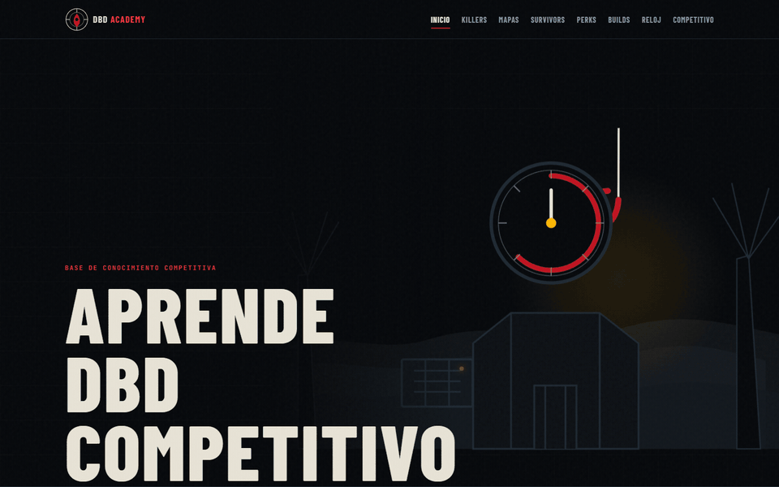
</p>

---

## Qué incluye

| Sección | Qué encuentras | Ruta |
| --- | --- | --- |
| **Killers** | Ficha de cada killer: velocidad, radio de terror, poder, perks propios, ventaja de velocidad y su tier competitivo. Filtros por tier y búsqueda. | `/killers/` |
| **Mapas** | Tamaño en tiles y m², tiempo de cruce, reino y el pool de mapas del formato 1v1. | `/mapas/` |
| **Survivors** | Los 55 survivors con sus perks propios y cuáles están baneados en 1v1. | `/survivors/` |
| **Perks** | Biblioteca de 342 perks con descripción oficial, etiquetas y marca de baneo. | `/perks/` |
| **Builds** | 28 builds (16 de killer, 12 de survivor) y un laboratorio para armar el tuyo con avisos de reglas. | `/builds/` |
| **El reloj** | Cronómetro de generador, línea del trial, reloj del gancho y calculadora de persecución. | `/reloj/` |
| **Competitivo** | Formato 1v1, perks baneados, escalera de tiers, reglas por killer y glosario. | `/competitivo/` |

## Capturas

<table>
  <tr>
    <td width="50%">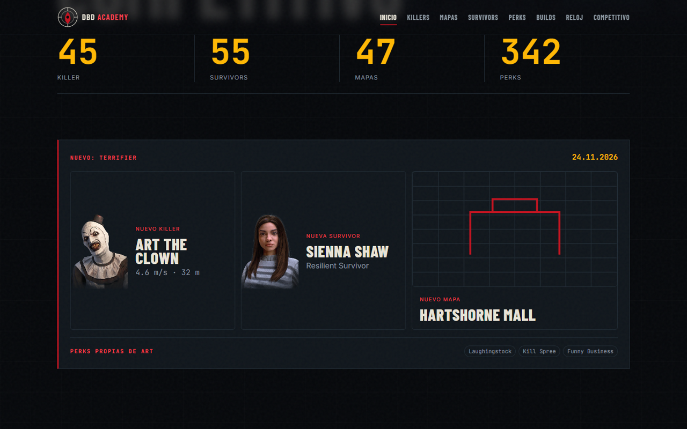<br><sub>Terrifier: Art the Clown, Sienna Shaw y Hartshorne Mall.</sub></td>
    <td width="50%">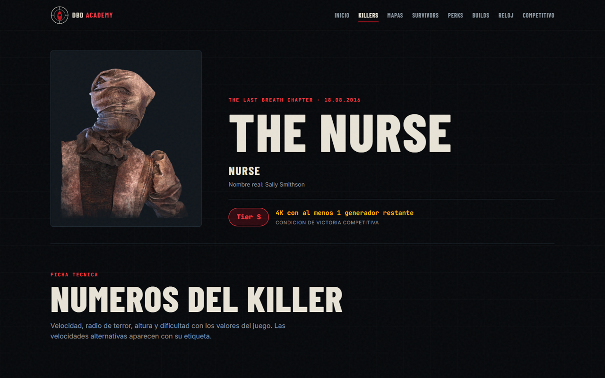<br><sub>Ficha de killer con su condición de victoria competitiva.</sub></td>
  </tr>
  <tr>
    <td width="50%">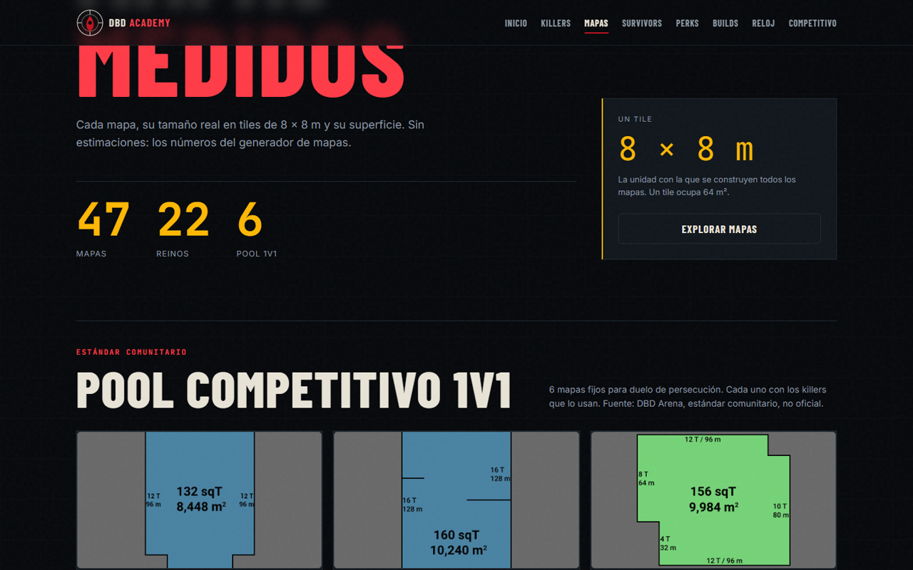<br><sub>Mapas agrupados por reino y pool 1v1.</sub></td>
    <td width="50%">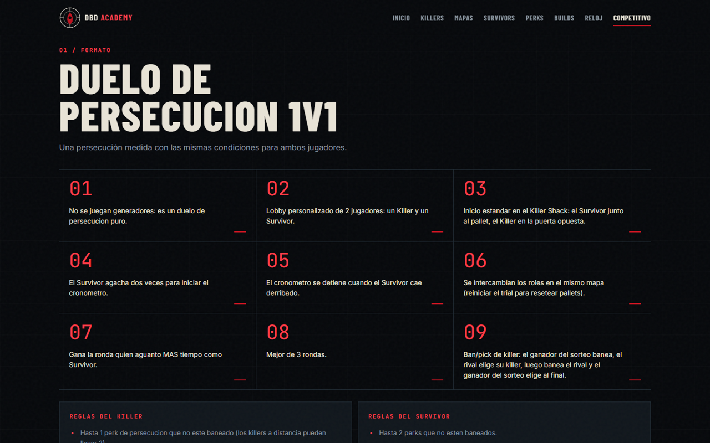<br><sub>Formato 1v1, bans y tiers.</sub></td>
  </tr>
  <tr>
    <td width="50%">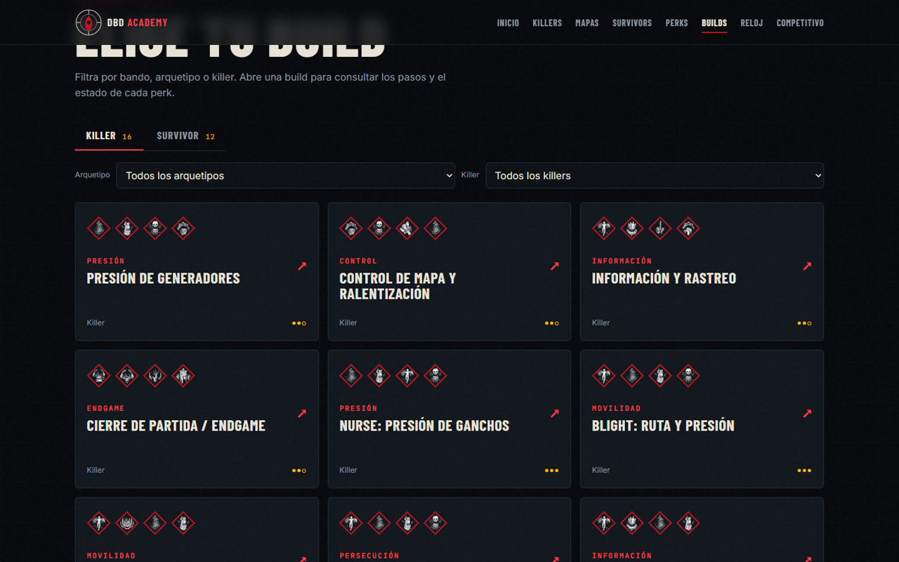<br><sub>Builds y laboratorio de perks.</sub></td>
    <td width="50%">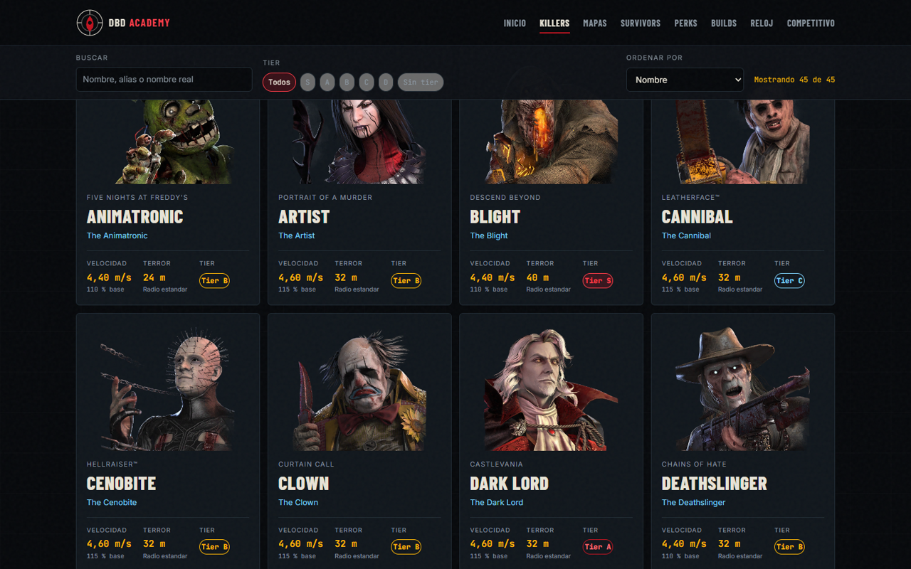<br><sub>Roster completo con filtros.</sub></td>
  </tr>
</table>

## El reloj

Todas las cifras base salen del [wiki oficial](https://deadbydaylight.wiki.gg) (parche 10.3.0) y se guardan en [`data/clock.json`](data/clock.json).

<p align="center">
  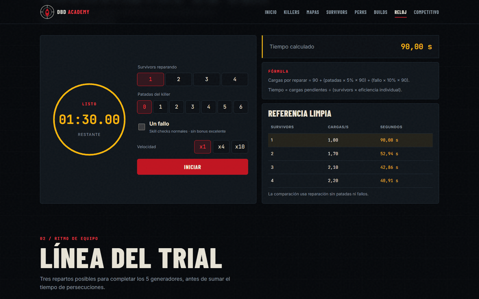
</p>

| Survivors en el gen | Eficiencia individual | Tiempo para 90 cargas |
| :---: | :---: | :---: |
| 1 | 100 % | **90,00 s** |
| 2 | 85 % | **52,94 s** |
| 3 | 70 % | **42,86 s** |
| 4 | 55 % | **40,91 s** |

- Cada patada del killer suma `5 % x 90` cargas por rehacer; un skill check fallido suma `10 % x 90`.
- Gancho: 70 s en la etapa 1 y 70 s en la etapa 2; autodescolgarse tiene 4 % de éxito por intento.
- Puerta de salida: 20 s. Velocidad base: survivor 4,0 m/s, killer 4,6 m/s.
- Los "objetivos de ritmo" del sitio son guías de entrenamiento derivadas de estas cifras, no reglas oficiales.

<p align="center">
  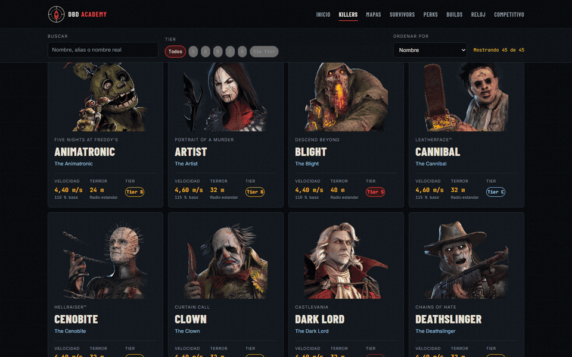
</p>

## Sobre lo competitivo

Dead by Daylight **no tiene un ranking competitivo oficial**: cada organizador define sus reglas. El sitio usa el estándar comunitario de [DBD Arena](https://www.dbdarena.com/tier-list) (formato 1v1 de persecución, perks baneados, tiers y mapas fijos) y lo declara en cada pantalla donde aparece. Judgment y Terrifier figuran como "sin tier" porque esa fuente todavía no los clasifica. Los builds son criterio editorial basado en la meta comunitaria de noviembre de 2026.

## Cómo está hecho

<p align="center">
  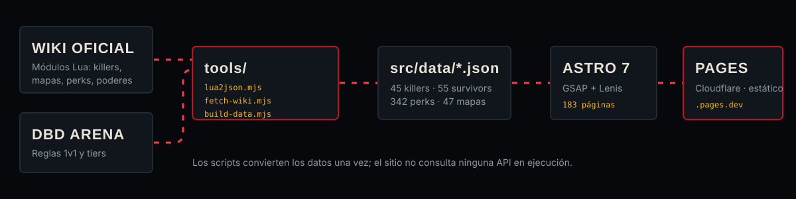
</p>

- **Astro 7** genera 183 páginas estáticas a partir de JSON; no hay servidor ni API en ejecución.
- **GSAP + Lenis** para revelados, contadores, relojes SVG y scroll suave, con soporte de `prefers-reduced-motion`.
- **Tipografías locales** (Barlow Condensed, Inter, JetBrains Mono) sin CDN.
- **Datos reproducibles**: `tools/` descarga y convierte los módulos Lua del wiki a JSON.
- **Pruebas**: `tests/data.test.mjs` valida los datos y `tools/check-links.mjs` revisa enlaces e imágenes.

```text
src/
  pages/        killers, mapas, survivors, perks, builds, reloj, competitivo
  components/   Nav, Footer, PerkCard, Portrait, TierBadge, reloj/, builds/ ...
  data/         JSON generados (no editar a mano, salvo builds.json)
  scripts/      motion.js (Lenis + GSAP)
data/           clock.json, comp-rules.json, comp-tiers.json, raw/
tools/          lua2json, fetch-wiki, build-data, check-links, capture
```

## Puesta en marcha

```bash
npm install
npm run dev        # http://localhost:4420
npm run build      # genera dist/
npm test           # valida los datos
```

Para regenerar los datos desde el wiki (necesita red; los módulos Lua van a `data/raw/`):

```bash
for m in Datatable Datatable/Loadout; do curl -s -A "dbd-academy" "https://deadbydaylight.wiki.gg/index.php?title=Module:$m&action=raw" -o "data/raw/$(echo $m | tr / _).lua"; done
node tools/lua2json.mjs data/raw/Datatable.lua data/raw/datatable.json killers maps realms survivors dlcs
node tools/lua2json.mjs data/raw/Datatable_Loadout.lua data/raw/loadout.json perks powers items
node tools/fetch-wiki.mjs
npm run datos
```

## Despliegue

El sitio se publica en **Cloudflare Pages** (`dbd-academy.pages.dev`):

```bash
npx wrangler login
npm run deploy     # build + wrangler pages deploy
```

En Windows basta con abrir `desplegar.cmd`.

## Fuentes y créditos

- Datos del juego: [wiki oficial de Dead by Daylight](https://deadbydaylight.wiki.gg).
- Reglas, tiers y mapas del formato 1v1: [DBD Arena](https://www.dbdarena.com) (proyecto comunitario).
- Anuncio del capítulo Terrifier: cobertura de Shacknews, Dread Central e Insider Gaming.

## Aviso legal

Proyecto de fans, sin relación con Behaviour Interactive. *Dead by Daylight*, sus killers, survivors, perks, mapas e imágenes son propiedad de Behaviour Interactive y de los titulares de cada licencia (por ejemplo, *Terrifier*); se muestran con fines informativos y educativos. Las descripciones de perks y poderes se muestran en su texto oficial en inglés. El código se publica bajo licencia MIT (ver [`LICENSE`](LICENSE)); la licencia **no** cubre las imágenes ni los nombres del juego.
